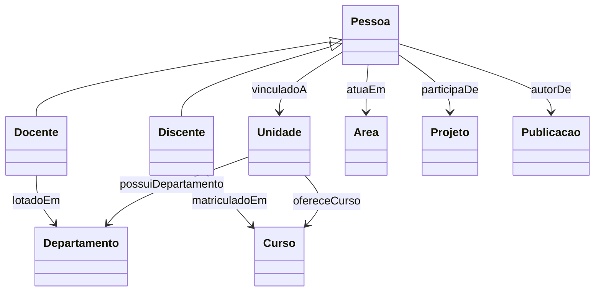

# Ontologia de aplicação

## Diagrama conceitual

## Classes
Pessoa, Docente, Discente, Unidade, Departamento, Curso, Area, Projeto, Publicacao. `Docente` e `Discente` são subclasses de `Pessoa` e disjuntas entre si.

## Propriedades e restrições
As propriedades de objeto têm `rdfs:domain` e `rdfs:range` declarados em `ontologia/ontologia.owl`. As propriedades `anoIngresso` e `anoPublicacao` têm alcance `xsd:gYear`. Não foram declaradas cardinalidades mínimas OWL, pois a demonstração não exige mundo fechado. Campos obrigatórios são verificados na validação do JSON.

## Modelo conceitual
Pessoas vinculam-se a uma Unidade; docentes são lotados em Departamento, discentes matriculam-se em Curso; pessoas atuam em Áreas, participam de Projetos e são autoras de Publicações. Publicações com múltiplos autores permitem recuperar coautorias.

## Expansão do modelo e especificações formais

Para contemplar todos os campos dos modelos de perfil, a ontologia incorpora a classe `voc:GrupoPesquisa` e a propriedade de objeto `voc:integraGrupo` (`voc:Pessoa` $\rightarrow$ `voc:GrupoPesquisa`), além da reutilização de `foaf:mbox`, `foaf:homepage` e `rdfs:seeAlso` para contatos e perfis acadêmicos externos.

### Resumo de hierarquias, domínios, alcances e restrições

| Elemento | Tipo OWL / RDFS | Domínio (`rdfs:domain`) | Alcance (`rdfs:range`) | Axiomas / Restrições |
| :--- | :--- | :--- | :--- | :--- |
| `voc:Pessoa` | `owl:Class` | — | — | `rdfs:subClassOf foaf:Person` |
| `voc:Docente` | `owl:Class` | — | — | `rdfs:subClassOf voc:Pessoa`; `owl:disjointWith voc:Discente` |
| `voc:Discente` | `owl:Class` | — | — | `rdfs:subClassOf voc:Pessoa`; `owl:disjointWith voc:Docente` |
| `voc:Area` | `owl:Class` | — | — | Alinhada a `skos:Concept` |
| `voc:GrupoPesquisa` | `owl:Class` | — | — | Classe de grupos e núcleos de pesquisa |
| `voc:vinculadoA` | `owl:ObjectProperty` | `voc:Pessoa` | `voc:Unidade` | Relaciona docentes e discentes à unidade acadêmica |
| `voc:lotadoEm` | `owl:ObjectProperty` | `voc:Docente` | `voc:Departamento` | Específica para docentes |
| `voc:matriculadoEm` | `owl:ObjectProperty` | `voc:Discente` | `voc:Curso` | Específica para discentes |
| `voc:atuaEm` | `owl:ObjectProperty` | `voc:Pessoa` | `voc:Area` | Associa pessoas às áreas temáticas |
| `voc:participaDe` | `owl:ObjectProperty` | `voc:Pessoa` | `voc:Projeto` | Associa pessoas a projetos de pesquisa |
| `voc:integraGrupo` | `owl:ObjectProperty` | `voc:Pessoa` | `voc:GrupoPesquisa` | Associa pessoas a grupos de pesquisa |
| `voc:autorDe` | `owl:ObjectProperty` | `voc:Pessoa` | `voc:Publicacao` | Associa pessoas às suas publicações |
| `voc:possuiDepartamento` | `owl:ObjectProperty` | `voc:Unidade` | `voc:Departamento` | Estrutura organizacional da unidade |
| `voc:ofereceCurso` | `owl:ObjectProperty` | `voc:Unidade` | `voc:Curso` | Estrutura acadêmica da unidade |
| `voc:anoIngresso` | `owl:DatatypeProperty` | `voc:Discente` | `xsd:gYear` | Ano de ingresso do discente |
| `voc:anoPublicacao` | `owl:DatatypeProperty` | `voc:Publicacao` | `xsd:gYear` | Ano da publicação |