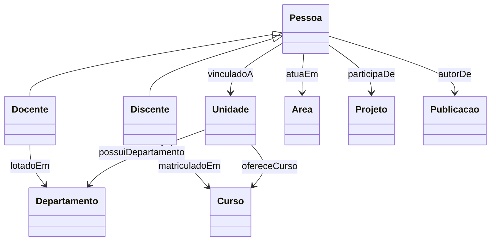

# Ontologia de aplicação

## Diagrama conceitual

## Classes
Pessoa, Docente, Discente, Unidade, Departamento, Curso, Area, Projeto, Publicacao. `Docente` e `Discente` são subclasses de `Pessoa` e disjuntas entre si.

## Propriedades e restrições
As propriedades de objeto têm `rdfs:domain` e `rdfs:range` declarados em `ontologia/ontologia.owl`. As propriedades `anoIngresso` e `anoPublicacao` têm alcance `xsd:gYear`. Não foram declaradas cardinalidades mínimas OWL, pois a demonstração não exige mundo fechado. Campos obrigatórios são verificados na validação do JSON.

## Modelo conceitual
Pessoas vinculam-se a uma Unidade; docentes são lotados em Departamento, discentes matriculam-se em Curso; pessoas atuam em Áreas, participam de Projetos e são autoras de Publicações. Publicações com múltiplos autores permitem recuperar coautorias.
